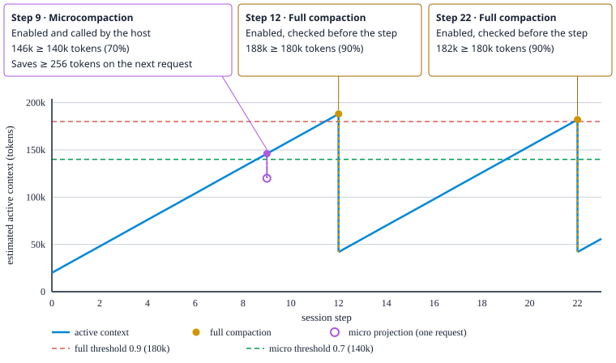
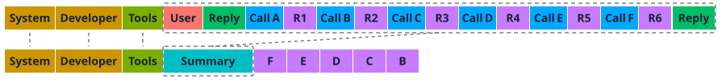
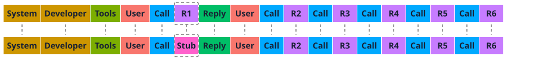

# Compression

[简体中文](compression.zh-Hans.md)

Long conversations are compressed so work can continue in a fresh context. This preset has two mechanisms: full compaction, which summarizes the conversation and then restores a bounded set of recently used files, and microcompaction, which clears old tool results. They are separate mechanisms.

The example uses a 200,000-token window. At the start of steps 12 and 22, active context has reached the default 90% threshold. Each full compaction reduces the context carried into later steps. Step 9 shows optional microcompaction. When enabled, a host call at or above 70% can shorten the next model request if it saves at least 256 estimated tokens. The hollow point shows that request’s size. Later steps continue along the solid line.

## Full compaction

Full compaction runs on the agent's pre-step scheduler. When the estimated token count crosses the configured threshold, the engine summarizes the compactable range of the conversation into one checkpoint, then restores up to five recently used files.

The assembled request keeps the system and developer instructions and the tool schemas. The compactable role-message range becomes a single summary checkpoint produced by the model. The engine rereads recent files from disk and appends their current contents after the summary.

The restore is bounded in three ways: at most five files, at most 5000 tokens per file, and at most 50000 tokens in total. Only files touched by Read, Write or Edit qualify, and they are selected newest first. The plan file, instruction files and the memory index are excluded. Before each file is read, the engine authorizes it through the real Read tool's policy path, checking the requested spelling, the cwd-resolved requested path and the canonical path. A denied file still counts toward the five-file limit. A file over the per-file cap appears only as a reference notice.

In the figure, six files A to F are read in order, A oldest to F newest. After the summary, the five newest files F, E, D, C and B are restored. The oldest file A is not restored, because the restore keeps at most five.

Full compaction is on by default. The threshold is the `compactionThreshold` setting, 0.9 by default. If the summary model call ends at its token cap, the compaction fails and leaves the surface and event stream untouched.

## Microcompaction

Microcompaction clears the text of old tool results inside a single request projection. It is off by default and must be enabled through `microcompactionEnabled`.

Microcompaction runs only when the host calls `compactIfNeeded` and the estimated token count is at or above the `microcompactionThreshold` ratio of the context window, 0.7 by default. There is no automatic trigger in the installed code, and there is no upper bound: it can run at any size at or above the threshold. When it runs, it keeps ordinary messages and the five most recent compactable tool results, and replaces the text of older compactable tool results with a fixed placeholder. For a tool message with several text blocks, only the first text block is replaced. The change is applied only when it saves at least 256 estimated tokens.

Only the next model request uses the shortened tool results. The session history retains the original messages.

## Settings

The preset uses a window ratio for full compaction. Upstream ZCode starts with a default 200,000-token window, subtracts an output reserve and a 13,000-token buffer, and stops automatic retries after three consecutive failures. Its post-compaction restore supplies the file limits described above. Upstream microcompaction applies a tool-name filter, keeps five eligible results and requires savings of at least 256 tokens. [Threshold policy](https://github.com/zai-org/ZCode/blob/fec975905a2abd4c07e35c40d51fa097a2258ec9/apps/zcode-cli/packages/core/src/compact/policy.ts) · [File restoration](https://github.com/zai-org/ZCode/blob/fec975905a2abd4c07e35c40d51fa097a2258ec9/apps/zcode-cli/packages/core/src/runtime/helpers/compact-post-reminders.ts) · [Microcompaction](https://github.com/zai-org/ZCode/blob/fec975905a2abd4c07e35c40d51fa097a2258ec9/apps/zcode-cli/packages/core/src/compact/microcompact.ts)

| Setting | Default | Effect |
| --- | --- | --- |
| `compactionEnabled` | On | Enables full compaction. |
| `compactionThreshold` | 0.9 | Context pressure ratio that triggers full compaction. |
| `microcompactionEnabled` | Off | Enables microcompaction. |
| `microcompactionThreshold` | 0.7 | Context pressure ratio that triggers microcompaction. |
