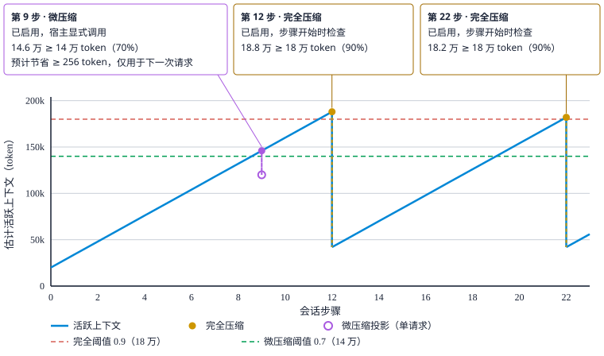

# 压缩

[English](compression.md)

完全压缩会总结对话，再恢复最近使用的文件。微压缩可单独启用，用于缩短旧的工具结果。

图中以 20 万 token 的上下文窗口为例。第 12 步和第 22 步开始时，活跃上下文均已达到默认的 90% 阈值。每次完全压缩后，后续对话都从较小的上下文继续。第 9 步展示了可选的微压缩：启用后，若宿主在用量达到 70% 时调用微压缩，且预计能节省至少 256 个 token，下一次模型请求就会使用空心点标出的较小上下文。随后的步骤仍沿实线继续。

## 完全压缩

完全压缩运行在 agent 的预步骤调度器上。当估计的 token 数超过配置的阈值时，引擎把对话中可压缩的范围总结为一个检查点，然后恢复至多五个最近使用的文件。

组装后的请求保留系统与开发者指令以及工具 schema。可压缩的角色消息范围变为由模型生成的单个摘要检查点。引擎从磁盘重新读取最近使用的文件，将当前内容附在摘要之后。

恢复在三个方面有界：至多五个文件，每个文件至多 5000 token，总量至多 50000 token。只有被 Read、Write 或 Edit 触碰过的文件符合条件，并按从新到旧选择。plan 文件、指令文件和记忆索引被排除。每个文件被读取之前，引擎通过真实 Read 工具的策略路径对其进行授权，检查请求拼写、cwd 解析后的请求路径和规范路径。未获授权的文件会被跳过，仍占一个名额。超过单文件上限时仅附上引用提示。

图中按顺序读取六个文件 A 到 F，A 最旧，F 最新。摘要之后，恢复最新的五个文件 F、E、D、C、B。最旧的文件 A 不恢复，因为恢复至多保留五个。

完全压缩默认开启。阈值是 `compactionThreshold` 设置，默认为 0.9。如果摘要模型调用在其 token 上限处结束，压缩失败，并使表面和事件流保持原样。

## 微压缩

微压缩在单个请求投影内清除旧工具结果的文本。它默认关闭，必须通过 `microcompactionEnabled` 启用。

微压缩仅在 host 调用 `compactIfNeeded` 且估计的 token 数达到或高于上下文窗口的 `microcompactionThreshold` 比例时运行，该比例默认为 0.7。已安装的代码中没有自动触发，也没有上限：它可以在达到或高于阈值的任何规模运行。运行时，它保留普通消息和最近五个可压缩的工具结果，并把更早的可压缩工具结果的文本替换为固定占位符。对于含多个文本块的工具消息，只替换第一个文本块。仅当节省至少 256 个估计 token 时才应用更改。

只有下一次模型请求使用缩短后的工具结果。会话记录保留原始消息。

## 设置

本预设按窗口使用比例触发完全压缩。上游 ZCode 的默认窗口为 200000 token，计算阈值时会扣除输出预留量和 13000 token 缓冲区。连续失败三次后，上游会停止自动重试。上文列出的文件恢复上限也来自上游。上游微压缩按工具名筛选结果，保留最近五条符合条件的结果，至少节省 256 token 才会生效。[阈值策略](https://github.com/zai-org/ZCode/blob/fec975905a2abd4c07e35c40d51fa097a2258ec9/apps/zcode-cli/packages/core/src/compact/policy.ts) · [文件恢复](https://github.com/zai-org/ZCode/blob/fec975905a2abd4c07e35c40d51fa097a2258ec9/apps/zcode-cli/packages/core/src/runtime/helpers/compact-post-reminders.ts) · [微压缩](https://github.com/zai-org/ZCode/blob/fec975905a2abd4c07e35c40d51fa097a2258ec9/apps/zcode-cli/packages/core/src/compact/microcompact.ts)

| 设置 | 默认值 | 作用 |
| --- | --- | --- |
| `compactionEnabled` | 开 | 启用完全压缩。 |
| `compactionThreshold` | 0.9 | 触发完全压缩的上下文压力比例。 |
| `microcompactionEnabled` | 关 | 启用微压缩。 |
| `microcompactionThreshold` | 0.7 | 触发微压缩的上下文压力比例。 |
